# Bài 2 4 5: Vẽ heap thu được khi thêm các khóa sau vào 1 heap max ban đầu rỗng 
E A S Y Q U E S T I O N

** Lời giải **

KQ: 

Theo từng bước thêm :

B1: Thêm E

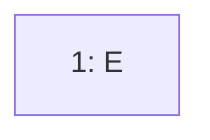
B2:Thêm A

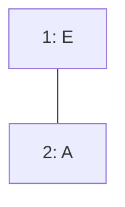

B3 : Thêm S vào vị trí 3 và swim lên 
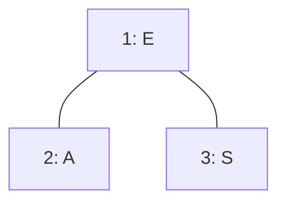

So sánh ta thấy S > E nên S swim lên vị trí E 

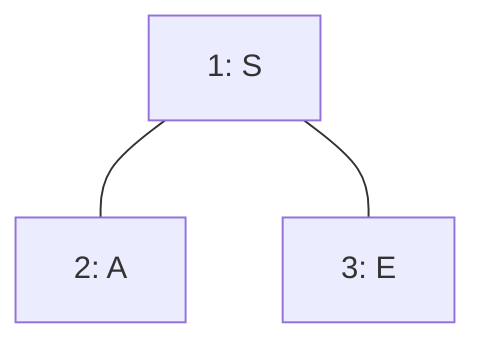

B4: Thêm Y vào vị trí k = 4 và so sánh để swim lên
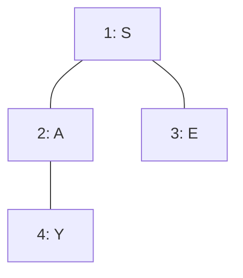

So sánh ta thấy Y > A nên swap(A,Y), so sánh Y>S swap(Y,S)

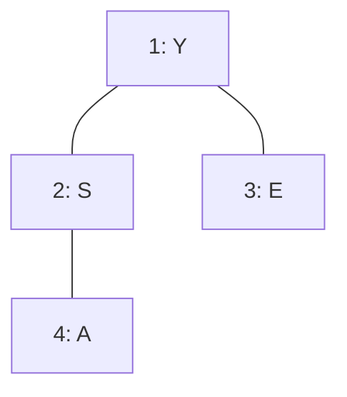
B5 : Thêm Q vào và swim lên

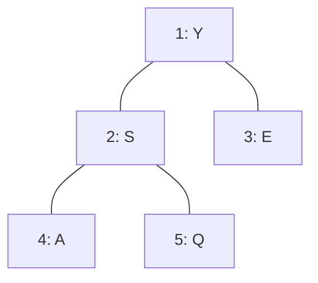

B6 : Thêm U vào 
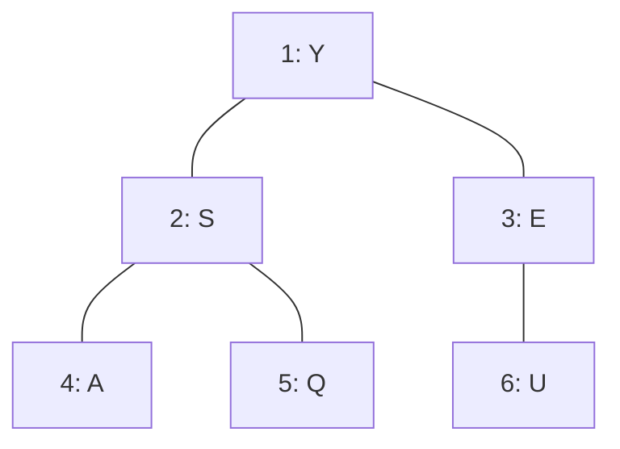
So sánh thấy U > E ta swim U lên

B7 : Thêm E vào 
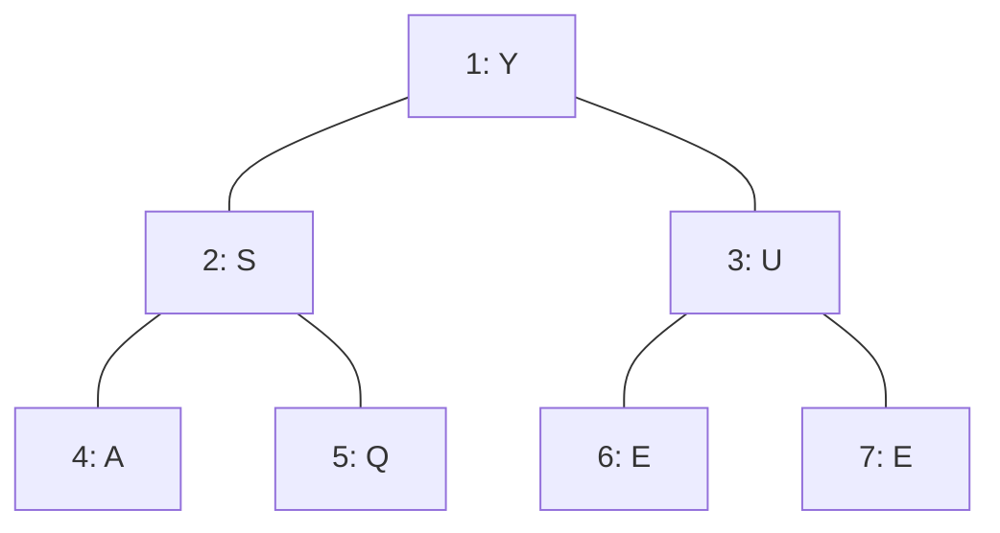

B8 : Thêm S vào 
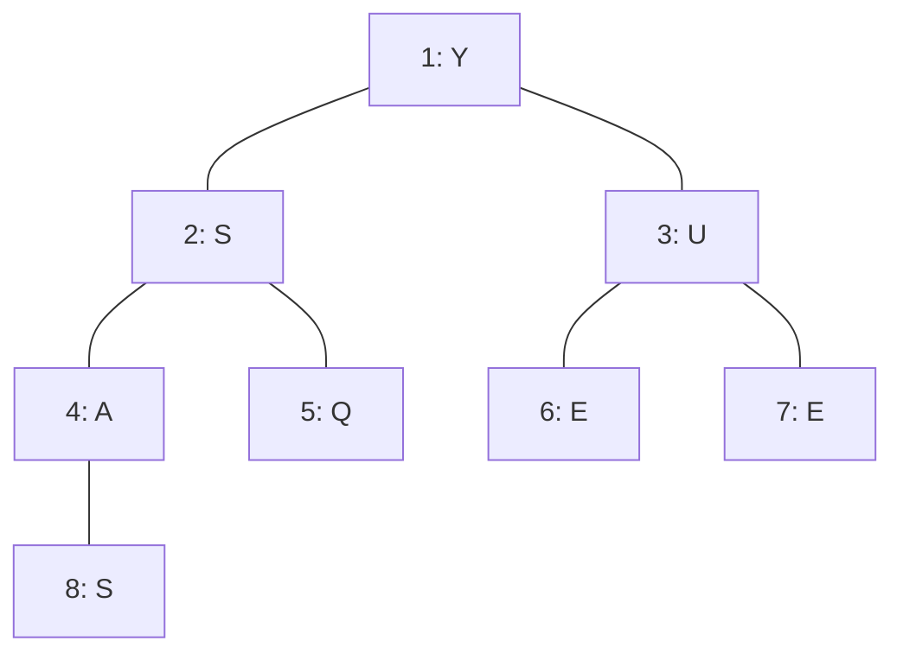
So sánh thấy S > A ta swim S lên

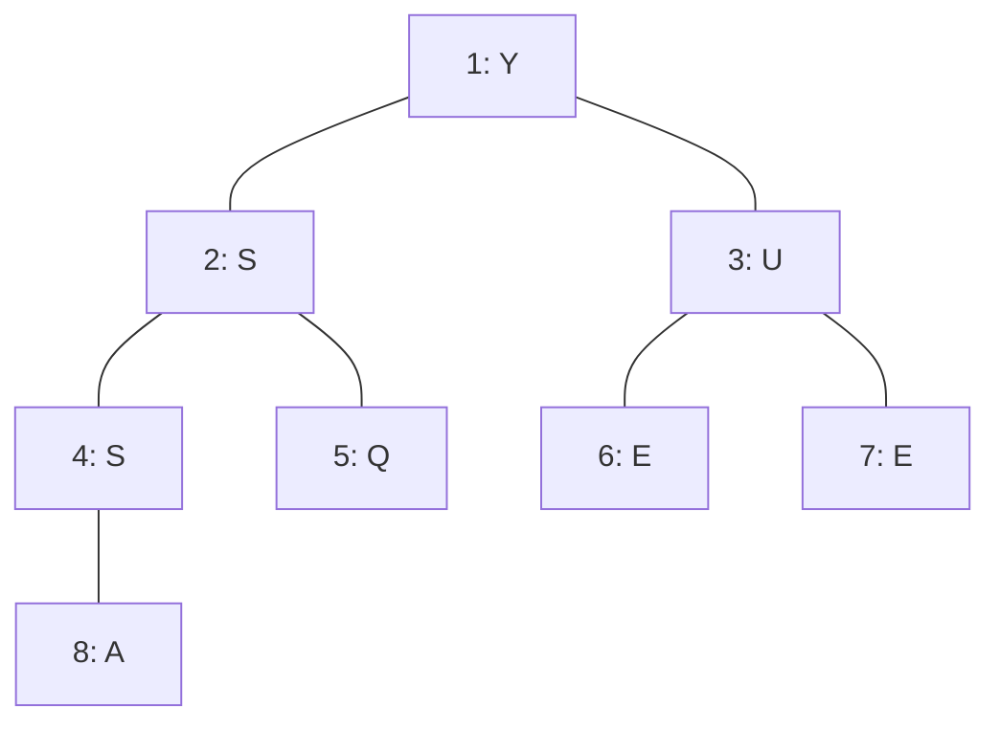

B9: Thêm T vào 

Ta thấy T > S nên T swim lên
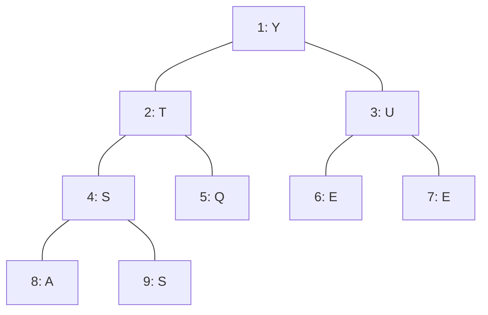

B10 : Thêm I vào 
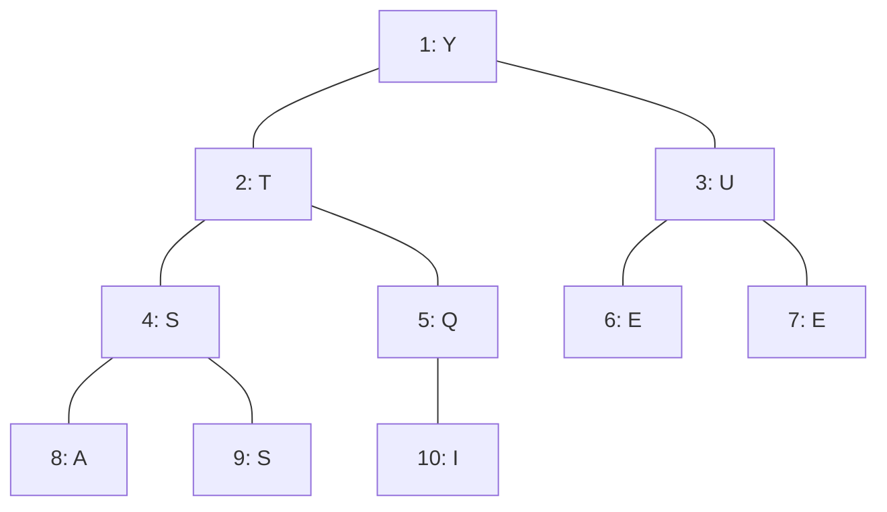

Bước 11 : Thêm O vào 
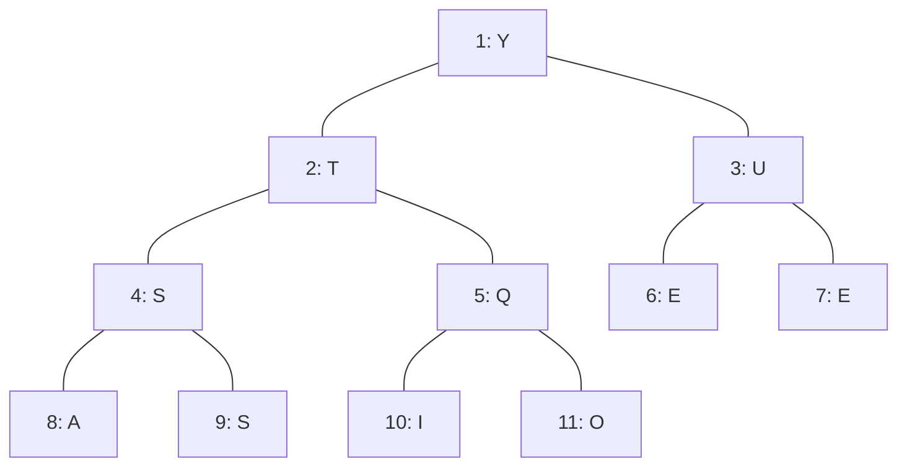

Bước 12 : Thêm N vào 
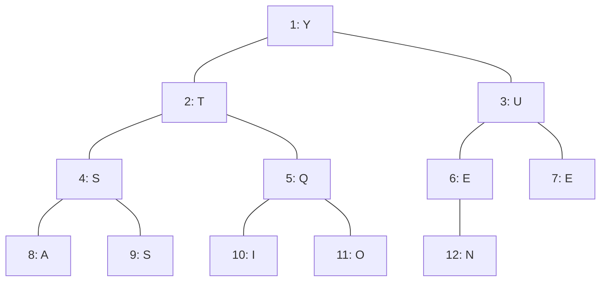
so sánh ta thấy N > E swim N lên 

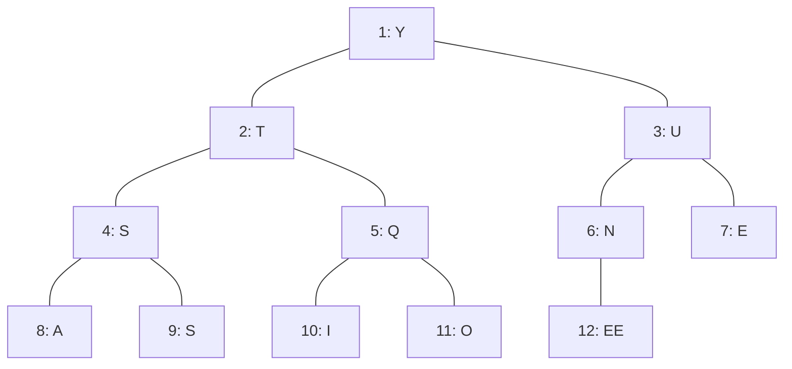